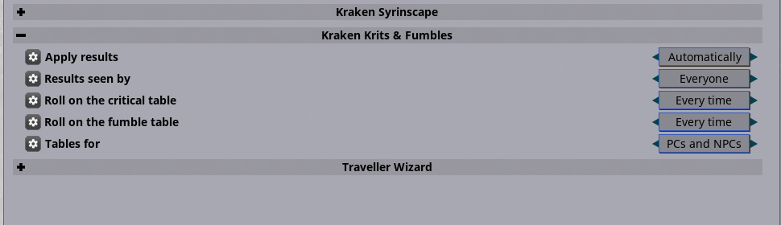

# Kraken Krits & Fumbles Traveller

Critical hits and fumbles with a table for Traveller (Mongoose 2E), applied in Fantasy Grounds Unity.

Boxcars (natural 12) on an attack rolls a **Telling Shot** (ranged or melee, d12); snake eyes rolls a **Firefight Fumble**, unless the ruleset's own Combat Mishaps option is on (it rolls the Core Rulebook's mishap table then). Results go to chat with reminders on the tracker; the Referee applies the numbers (Traveller's effects have no tags for these).

## What is applied

- Conditions and penalties go on the combat tracker as effects (prone, blinded, bleeding,
  attack and armour penalties, lost actions), with their duration.
- Extra damage and self damage are real damage rolls in chat, applied the ruleset's way.
- "Maximum damage", "extra die" and "double" results mark the attacker; its next damage roll
  is changed and the mark is removed.
- What Fantasy Grounds cannot track (dropped weapons, maiming, instant death) is announced to
  the GM in the same chat line.
- Player and GM rolls both work (the host applies the results).

## Options (Options > Kraken Krits & Fumbles)

| Option | Values |
| --- | --- |
| Roll on the critical table | Off / Every time / 1 in 2 / 1 in 3 |
| Roll on the fumble table | Off / Every time / 1 in 2 / 1 in 3 |
| Apply results | Automatically / Chat only |
| Tables for | PCs and NPCs / PCs only |
| Results seen by | Everyone / GM only |

`/krakenkrits crit [weapon]` and `/krakenkrits fumble [weapon]` roll a test result for the first two tracker
entries; `/krakenkrits tables` lists the tables.

Results print `[KRAKEN CRITICAL]` / `[KRAKEN FUMBLE]`, which the Kraken Syrinscape extensions play a sound for.

## Install

Copy `KrakenKritsTraveller` into the Fantasy Grounds `extensions` folder and tick it for a Traveller (Mongoose 2E) campaign.
